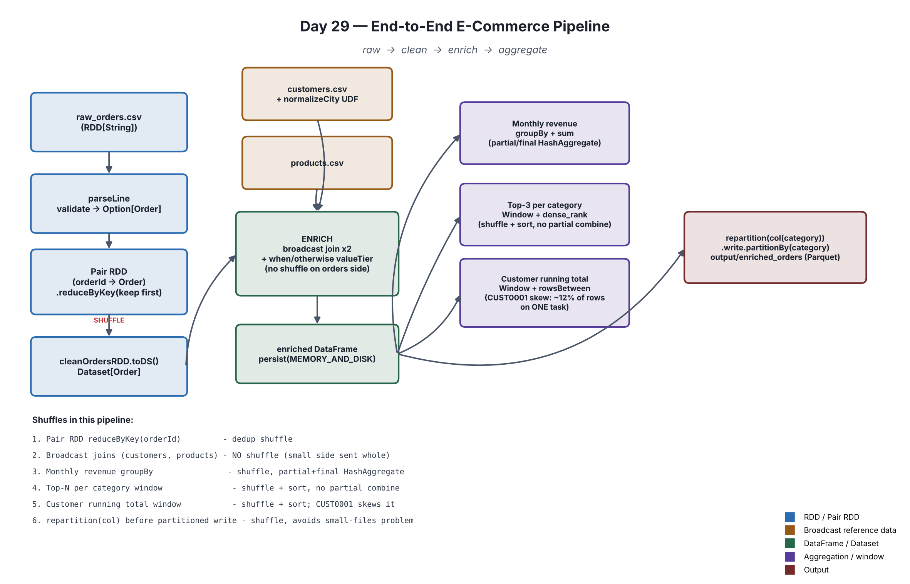

# Day 29 — End-to-End E-Commerce Project

A production-style batch pipeline: raw CSV → clean (RDD) → enrich
(DataFrame, broadcast joins, one UDF) → aggregate (window functions) →
partitioned Parquet output, with every shuffle and optimization choice
explained in both the code's comments and the console output when it runs.



**Scenario:** ~12,000 raw e-commerce orders, a 200-row customer directory,
and a 60-row product catalog. The data is deliberately messy (missing
fields, orphan ids, malformed dates/quantities, duplicate order ids, dirty
city spellings) and deliberately skewed — one customer, `CUST0001`, is
responsible for ~12% of all orders, specifically to make data skew a real,
visible problem rather than an abstract warning.

## The 6 requirements, and where they live

### 1. Raw → clean → enrich → aggregate pipeline

The whole shape of `main()` in `ECommercePipelineApp.scala`, in order:
`rawToCleanRDD` → `enrichOrders` → `aggregateMonthlyRevenue` /
`topProductsPerCategory` / `customerRunningTotal` → `writePartitionedOutput`.
See the diagram above or `explainPipelineOverview()`'s console output for
the same shape as an ASCII sketch.

### 2. RDD/Pair RDD for one component, DataFrame/Dataset for another

- **RDD/Pair RDD** — `rawToCleanRDD`: reads `raw_orders.csv` as
  `RDD[String]`, parses and validates each line (`parseLine`), then
  deduplicates by `orderId` using a genuine **Pair RDD**:
  `validOrders.map(o => (o.orderId, o)).reduceByKey((first, _) => first)`.
  This solves a real problem in the seeded data — `raw_orders.csv` has
  ~1% exact-duplicate `orderId` rows.
- **DataFrame/Dataset** — everything from `cleanOrdersRDD.toDS()` onward:
  the enrichment joins, the UDF, every aggregation, and the window
  functions all use the DataFrame/Dataset API.

### 3. UDF only where necessary

- **Used**: `normalizeCityUDF`, wrapping the plain Scala function
  `normalizeCity`, maps ~20 real-world city-spelling variants
  ("Bangalore"/"banglore"/"BLR"/"bengaluru " → `Bengaluru`) via a lookup
  table. A `when/otherwise` chain would duplicate the same table as an
  unreusable, untestable expression tree — the UDF, being a plain function,
  is independently unit-testable outside Spark entirely.
- **Not used**: `valueTier` (LOW/MEDIUM/HIGH/PREMIUM from `revenue`) uses a
  built-in `when/otherwise` chain instead — a fixed set of numeric
  thresholds is exactly what Catalyst's native expressions already handle,
  so a UDF there would be the unnecessary kind this requirement warns
  against.
- The README and code both call out *why* the UDF's cost is acceptable
  here: it only ever runs over `customers.csv` (200 rows, a **dimension**
  table), never over the 12,000-row **fact** table — a UDF's cardinality of
  use matters as much as whether one is used at all.

### 4. Joins, windows, partitioning, and persistence

- **Joins**: both `customers` and `products` are small enough to
  `broadcast(...)`, forcing a `BroadcastHashJoin` — zero shuffle on the
  large orders side for either join.
- **Windows**: `topProductsPerCategory` (`Window.partitionBy("category")` +
  `dense_rank`) and `customerRunningTotal` (`Window.partitionBy("customerId")`
  + `rowsBetween(unboundedPreceding, currentRow)`).
- **Partitioning**: `spark.sql.shuffle.partitions` set explicitly to 8
  (not the cluster-scale default of 200); `repartition(col("category"))`
  before the final partitioned Parquet write, to avoid a small-files
  problem.
- **Persistence**: the enriched DataFrame is `persist(MEMORY_AND_DISK)`'d
  immediately after the joins, since it feeds three independent
  aggregations plus the final write — materialized once, read from cache
  every time after.

### 5. Explain every shuffle, stage, and optimization choice

Every stage prints its own `.explain("formatted")` physical plan plus a
plain-English explanation immediately before it runs, and
`explainShufflesAndStages()` at the end prints a full structured summary of
all 7 shuffles in the pipeline — including an honest explanation of why
Spark 3.5's adaptive skew-join handling does **not** rescue the
`CUST0001`-skewed running-total window (AQE's skew optimization only
rewrites sort-merge *joins*, not window partition shuffles — a window
genuinely needs its whole, correctly-ordered partition in one place).

### 6. Production-style README and architecture diagram

This file, plus `docs/architecture.png` (regenerated from a small
matplotlib script, not hand-drawn) showing every stage, which operations
shuffle vs. don't, and where the data skew bites.

## Project layout

```
day29-ecommerce-e2e-project/
├── build.sbt
├── docs/architecture.png
├── src/main/resources/
│   ├── raw_orders.csv      (~12,120 rows, seeded edge cases + skew)
│   ├── customers.csv       (200 rows, seeded dirty city spellings)
│   ├── products.csv        (60 rows, across 6 categories)
│   └── log4j2.properties
└── src/main/scala/day29/ECommercePipelineApp.scala
```

## Data dictionary

| File | Columns | Notes |
|---|---|---|
| `raw_orders.csv` | orderId, customerId, productId, quantity, orderDate, status | status ∈ {COMPLETED, CANCELLED, RETURNED}. Seeded: ~2% missing customerId, ~1.5% missing productId, ~1.5% orphan customerId, ~1.5% orphan productId, ~1.5% invalid quantity, ~1% malformed date, ~1% duplicate orderId. `CUST0001` holds ~12% of all rows (deliberate skew). |
| `customers.csv` | customerId, name, city, signupDate | `city` has ~5 dirty-spelling variants per canonical city, by design. |
| `products.csv` | productId, name, category, price, cost | 6 categories, 10 products each. |

## How to run

No feeder/socket needed — this is a one-shot **batch** job, not streaming.

```bash
cd ~
unzip /mnt/c/Users/seemr/Downloads/day29-ecommerce-e2e-project.zip
cd day29-ecommerce-e2e-project
export JAVA_HOME=/usr/lib/jvm/java-17-openjdk-amd64 && export PATH=$JAVA_HOME/bin:$PATH
sbt run
```

It prints every stage's stats, explain plan, and results to the console,
writes `output/enriched_orders/category=.../*.parquet`, then pauses ~10s
(Spark UI is at `http://localhost:4040` while it runs) before exiting on
its own — no Ctrl+C needed, and no second terminal.

## Things to try

- Open `http://localhost:4040` in a browser while it's running (within the
  ~10s pause at the end, or add a longer sleep) and compare the Jobs/Stages
  view against the shuffle list this README and the console output both
  describe.
- Check `output/enriched_orders/` — one subfolder per `category`, Parquet
  files inside.
- Change `spark.sql.shuffle.partitions` from 8 to 200 and compare how many
  (mostly-empty) tasks each stage shows in the Spark UI.
- Change the `customerRunningTotal` window to `Window.partitionBy("customerId", "productId")`
  and see how splitting `CUST0001`'s rows across more partition keys
  reduces (though doesn't eliminate) the skew.
