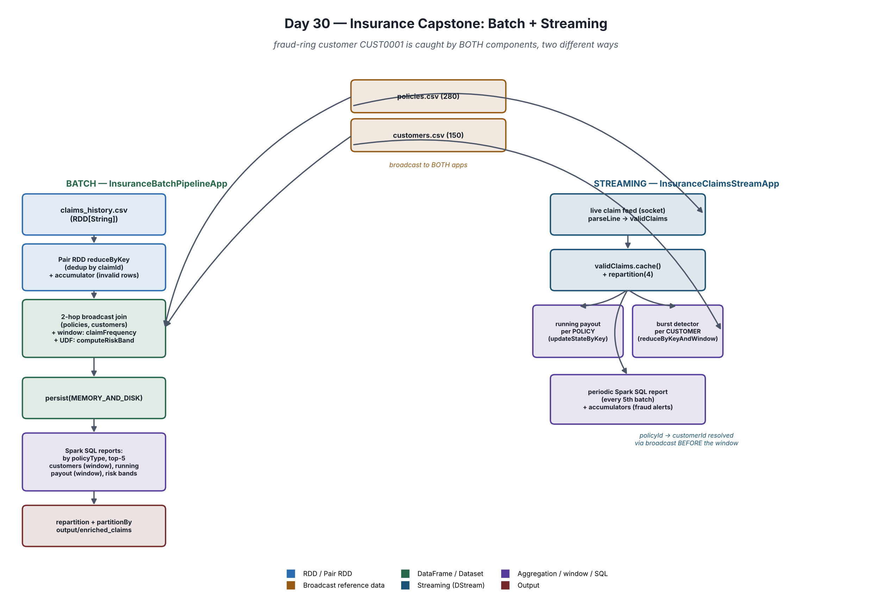

# Day 30 — Final Capstone: Insurance Claims Platform

A two-part capstone combining everything from Days 1-29: a **batch** claims
pipeline and a **streaming** fraud-detection app, sharing the same small
reference data, in the **insurance** domain. One seeded scenario — a
"fraud-ring" customer (`CUST0001`) responsible for ~10% of all historical
claims across 7 of their own policies — is designed to be caught by both
halves, in two different ways, so the capstone's techniques aren't just
demonstrated in isolation but actually solve the same realistic problem
from two angles.



See **`INTERVIEW_QA.md`** for 20 interview questions drawn directly from
this project's own design decisions, with full answers — use it to
practice explaining *why*, not just *what*.

## The 6 requirements, and where they live

### 1. Choose a domain

**Insurance.** Claims, policies, customers, risk banding, fraud detection —
a domain not yet covered across Days 1-29, chosen specifically so this
capstone isn't a rehash of an earlier day's scenario.

### 2. Batch and streaming components where appropriate

- **Batch** (`InsuranceBatchPipelineApp`) — a one-shot job over
  `claims_history.csv` (~10,100 historical claims), computing a
  *historical* per-customer fraud risk band. Right tool because the
  question ("how risky is this customer, overall?") needs the whole
  dataset at once and tolerates minutes of latency.
- **Streaming** (`InsuranceClaimsStreamApp`) — a long-running job over a
  live claim feed, watching for a customer filing an unusual *burst* of
  claims right now. Right tool because that question only makes sense
  computed continuously as data arrives.

### 3. Broadcast, accumulator, cache/persist, partition tuning

| Technique | Batch app | Streaming app |
|---|---|---|
| **Broadcast** | Two-hop join: claims→policies→customers, both tables broadcast | `policyLookupBC` — policies and customers pre-joined locally, broadcast as one map |
| **Accumulator** | `invalidClaimRows` — one-pass running total during RDD parsing | `totalClaimsSeen`, `highValueClaimsAcc`, `fraudAlertsAcc`, `flaggedCustomersAcc` (CollectionAccumulator) — running for the app's whole life |
| **Cache/persist** | `enriched.persist(MEMORY_AND_DISK)` — feeds 4 downstream reports + the write | `validClaims.cache()` — feeds 3 downstream chains |
| **Partition tuning** | `shuffle.partitions=8`; `repartition(col("policyType"))` before the partitioned write | `repartition(4)` after the single-receiver socket source |

### 4. Spark SQL, joins, aggregations, windows, and a UDF

- **Joins**: the two-hop broadcast join (batch); the pre-resolved broadcast
  lookup (streaming).
- **Aggregations**: claims/payout by policy type; accumulator-driven
  summaries (streaming).
- **Windows**: `claimFrequency` per customer (unbounded partition count,
  batch); top-5 customers by payout (`dense_rank`, batch); running payout
  over time (`rowsBetween`, batch); customer-level fraud burst
  (`reduceByKeyAndWindow`, streaming).
- **UDF**: `computeRiskBand(age, policyRiskLevel, claimFrequencyBand)` —
  used because it combines 3 independent factors (up to 36 combinations)
  that a `when/otherwise` chain would turn into an unreadable, untestable
  wall of conditions. `claimFrequencyBand` itself, by contrast, is a plain
  `when` chain — no UDF, because one number needs no UDF to bucket.

### 5. Explain DAG, lineage, stages, executors, YARN

`InsuranceBatchPipelineApp.explainDagLineageAndStages()` prints a full
walkthrough — DAG laziness, a live `toDebugString` lineage printout,
exactly where this pipeline's stage boundaries are (and why the broadcast
joins don't create any), and what an executor actually is.
`explainYarnDeployment()` on both apps covers the `spark-submit` command,
cluster vs client mode, and the streaming-specific requirement for an HDFS
checkpoint path.

### 6. 20 interview questions from your own project

See **`INTERVIEW_QA.md`**.

## Project layout

```
day30-insurance-capstone-project/
├── build.sbt
├── INTERVIEW_QA.md
├── docs/architecture.png
├── scripts/claims_feed_server.py       (streaming feeder)
├── src/main/resources/
│   ├── claims_history.csv   (~10,100 rows, batch input, seeded edge cases + skew)
│   ├── policies.csv         (280 rows, broadcast by both apps)
│   ├── customers.csv        (150 rows, broadcast by both apps)
│   └── log4j2.properties
└── src/main/scala/day30/
    ├── InsuranceBatchPipelineApp.scala
    └── InsuranceClaimsStreamApp.scala
```

## Data dictionary

| File | Columns | Notes |
|---|---|---|
| `claims_history.csv` | claimId, policyId, claimAmount, claimType, claimDate, status | status ∈ {APPROVED, REJECTED, PENDING}. Seeded: ~2% missing policyId, ~1.5% orphan policyId, ~1.5% invalid claimAmount, ~1% malformed date, ~1% duplicate claimId. `CUST0001` holds ~10% of all claims via 7 of their own policies. |
| `policies.csv` | policyId, customerId, policyType, premium, riskLevel, startDate | policyType ∈ {AUTO, HOME, HEALTH, LIFE, TRAVEL}, each with an inherent riskLevel. |
| `customers.csv` | customerId, name, age, city | |
| live claim feed (socket) | claimId, policyId, claimAmount, claimType, timestamp | 5 fields only — no `status`, since a just-submitted claim hasn't been adjudicated yet; no `customerId`, resolved via the broadcast lookup instead. |

## How to run

**Batch app** — one terminal, no feeder needed:

```bash
cd ~
unzip /mnt/c/Users/seemr/Downloads/day30-insurance-capstone-project.zip
cd day30-insurance-capstone-project
export JAVA_HOME=/usr/lib/jvm/java-17-openjdk-amd64 && export PATH=$JAVA_HOME/bin:$PATH
sbt run
```

Two main classes live in this project, so `sbt run` will prompt you to pick
one — enter the number for `InsuranceBatchPipelineApp`, or run it directly:

```bash
sbt "runMain day30.InsuranceBatchPipelineApp"
```

It prints every stage, writes `output/enriched_claims/policyType=.../*.parquet`,
then exits on its own.

**Streaming app** — two terminals:

Terminal 1:
```bash
python3 scripts/claims_feed_server.py
```

Terminal 2:
```bash
export JAVA_HOME=/usr/lib/jvm/java-17-openjdk-amd64 && export PATH=$JAVA_HOME/bin:$PATH
sbt "runMain day30.InsuranceClaimsStreamApp"
```

Let it run at least 2 minutes to see `CUST0001` trip a `[FRAUD ALERT]`
(bursts roughly every 45s) and a couple of `[SQL REPORT]`/
`[ACCUMULATOR SUMMARY]` blocks print. Stop with Ctrl+C in Terminal 2 first,
then Terminal 1.

## Things to try

- Run the batch app first, note `CUST0001`'s `CRITICAL` risk band and huge
  running payout in the reports — then run the streaming app and watch the
  same customer trip a live `[FRAUD ALERT]`, from an entirely different
  code path (claim-frequency scoring vs. real-time burst counting).
- Open `INTERVIEW_QA.md` and try answering each question from memory before
  reading the written answer.
- Change `burstClaimThreshold` or `burstWindow` in the streaming app and see
  how sensitive the fraud detector gets.
- Change `computeRiskBand`'s scoring thresholds in the batch app and re-run
  to see the risk-band distribution report shift.
